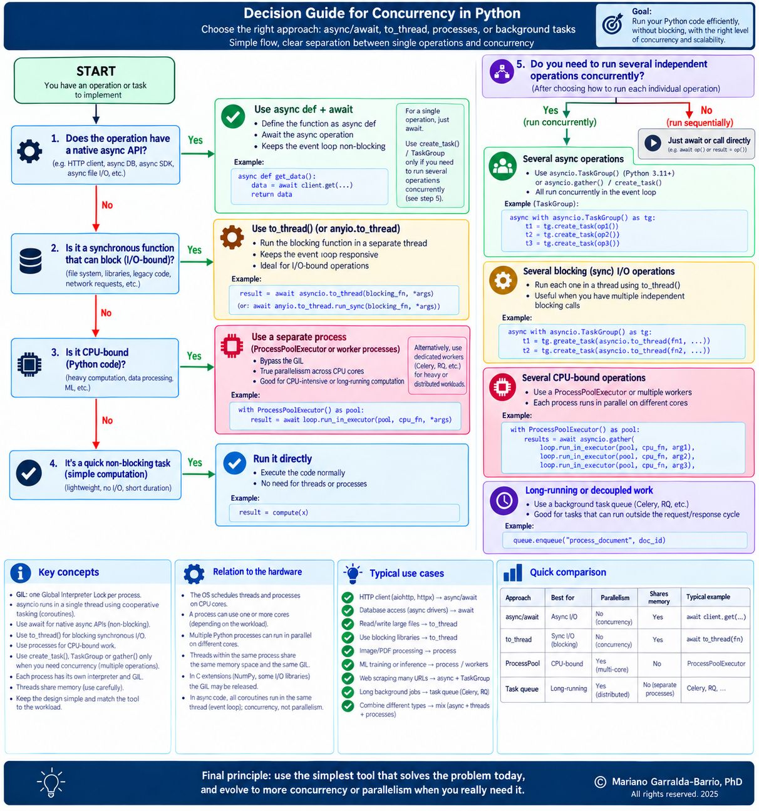

# Python Concurrency for Agent Runtimes and Knowledge Pipelines

A field guide to choosing an execution model for LLM calls, document ingestion, retrieval and indexing.

## Decision guide

[](python_concurrency.jpeg)

Once each operation has an execution model, decide which operations can overlap and whether the work belongs in the request or in a separate job.

## 1. Choose how each operation runs

| Operation | Default choice | Knowledge pipeline example |
|---|---|---|
| I/O through an asynchronous API | `await` the operation | Call an LLM, query a retrieval service or write to a database through an async client. |
| Blocking synchronous I/O in an async application | `asyncio.to_thread()` or `anyio.to_thread.run_sync()` | Read a document from disk or call a synchronous SDK. |
| Sustained CPU-bound work in pure Python | Use a reusable `ProcessPoolExecutor` when the workload justifies it | Transform a large batch of parsed documents with a CPU-intensive Python routine. |
| Brief local computation | Call the function directly | Normalize metadata or validate a field. |

A coroutine runs on the event loop's thread and yields control when it suspends. Declaring it with `async def` leaves any synchronous blocking calls inside it unchanged. For file and PDF processing, profile the stages separately. Reading bytes can be I/O-bound, while parsing and transformation may be CPU-bound.

Threads share process memory and can overlap blocking I/O. In CPython with the GIL enabled, Python bytecode execution is generally limited to one thread at a time per interpreter. Native extensions that release the GIL and free-threaded CPython builds can run CPU work in parallel across threads. Separate processes can run Python code in parallel across cores, with costs for startup, serialization and memory. Keep process-pool functions importable and arguments and results picklable. In a standalone script, protect the entry point with `if __name__ == "__main__":`.

## 2. Overlap independent work

If an operation needs the result of a previous step, await that step first. For independent operations, prefer `asyncio.TaskGroup` (Python 3.11+) when they should share a lifetime and a failure should cancel the remaining tasks. `asyncio.gather()` also schedules independent awaitables and returns their results in input order, with different failure semantics. Use `create_task()` when you need explicit control of a task's lifetime and keep track of it through completion.

For a small batch of independent LLM requests, use a semaphore to limit how many are in flight. For a large stream, use a bounded queue or batches to limit the number of pending tasks as well. Apply a separate rate limit when the provider constrains requests or tokens per time window.

For independent blocking I/O calls, the same task-group pattern can await several `to_thread()` calls. Cancelling an awaiting task does not forcibly stop a thread that has already started. For independent CPU-heavy calls, submit them to a bounded process pool using `loop.run_in_executor(pool, function, argument)` and await the results.

## 3. Choose the job lifetime

A repository-wide reindex may continue after the originating request ends. A job queue such as Celery or RQ can hand it to workers and support status tracking and retries. The worker still chooses the execution model for each operation. Use stable document IDs and idempotent writes so retries can safely repeat work.

## Worked example: ingest documents and index claims

Run [the complete Python example](ingest_claims.py) from the repository root with Python 3.11 or later. It uses the standard library, creates three temporary source files, and simulates an async LLM call with `asyncio.sleep()`. The index is an in-memory dictionary.

```bash
python field-guides/python-concurrency/ingest_claims.py
```

1. A `TaskGroup` runs one ingestion task per document. Each task reads its file with `asyncio.to_thread()` and normalizes the short text directly.
2. The task group can schedule all three documents. A shared semaphore gives only two tasks access to the extractor at once, modeling an upstream service with limited capacity. The third task waits for a slot while file reads and validation can continue.
3. Each task checks that the evidence quote appears verbatim in its source text, then adds the claim to the index under its document ID and version. Assessing whether a quotation supports a claim requires a separate check.

The trace shows when each document waits, starts and finishes extraction. With three documents and two slots, the third extraction starts after one of the first two finishes. File reads can complete in any order, so document names in the trace may vary. The script then prints the three indexed claims. For a repository-wide reindex, a queue worker can invoke the same ingestion flow as a job. A production index accessed through an async client would be written with `await`.


## CPU-bound example: build term counts

Run [the process-pool example](count_terms.py) when you want to see how independent CPU work can run across cores. It counts normalized terms in two synthetic documents with `ProcessPoolExecutor`. Each worker runs the same function on a separate document, and the parent associates the counts with their source IDs. Measure worker startup and data transfer costs before adopting a process pool for your workload.

```bash
python field-guides/python-concurrency/count_terms.py
```


## References

- [Python documentation on coroutines and tasks](https://docs.python.org/3/library/asyncio-task.html)
- [Python documentation on executors](https://docs.python.org/3/library/concurrent.futures.html)
- [Python documentation on asyncio and free-threaded Python](https://docs.python.org/3/library/asyncio-threading.html)
